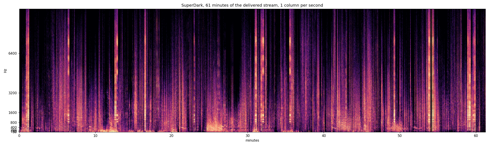

# One hour of the delivered stream — 3 Sept 2026, 17:41–18:42

The baseline. Every measurement in this project before this one was taken over
one to three minutes, and every one of them was consistent with a factory doing
the same thing forever. Roberto: *"I dare you to record a 1h spectrogram and look
at the predominant behaviours (fragmentation at different levels) and
variability."* This is that hour, and the next hour is to be compared against it
rather than against an impression.



## The build it was taken on

Commit `6e7cbf2`. Corpora at 0.06 / 0.35 / 0.80 s (2400 / 1800 / 3000 grains).
Macro layer on `\playgran` granular resynthesis, one grain per cloud. Anisotropic
pitch walk with `pitch_weight` 4.0, `pitch_hold` 3, drifting tonic. Three
concurrent layer slots. `master_gain` 1.2. 410 windows, zero errors, kernel
armed at edition 2, charter edition 6.

## Numbers

```
  61.2 minutes            rms 0.02273 (-32.9 dBFS)      peak 1.043

  FRAGMENTATION
    sounding runs n=6106   median 0.04s   p90 0.62s   max 116.38s
    gaps          n=6106   median 0.04s   p90 0.46s   max  11.36s
    by scale:   <0.35s 84.3%    0.35-0.8s 7.5%    0.8-4s 6.6%    >4s 1.6%

  HELD PITCH
    stable runs n=51953    median 0.02s   p90 0.07s   max 5.53s
      >=0.5s   84 runs,  4.5% of sounding time
      >=1.0s   33 runs,  2.9%
      >=2.0s    8 runs,  1.1%
      >=4.0s    1 run,   0.3%

  VARIABILITY, per minute across the hour
                       min    median      max      CV
    rms              0.005     0.017    0.062    0.59
    median run s     0.020     0.120   60.000    3.47
    quiet frac       0.000     0.084    0.643    1.16
    median held s    0.023     0.023    0.035    0.19
    max held s       0.163     0.569    4.865    1.01
```

## What it says

**Fragmentation is the dominant behaviour and now has a number.** 84.3% of
sounding runs are under 0.35 s; 1.6% exceed 4 s. The picture is vertical
striation almost everywhere, which is what onsets look like.

**Sustain is nevertheless possible: the longest continuous run was 116.38 s.**
The architecture can hold for nearly two minutes and almost never does. That is
a different and better problem than "it cannot".

**The factory does vary across the hour.** Per-minute CV of 3.47 on median run
length, 1.16 on quiet fraction, 1.01 on longest held pitch. One minute is 64%
quiet (visible around minute 26–29); minutes 31–32 and 54 are dense and bright.
Sixty identical minutes would show CVs near zero and these do not. The
three-slot architecture's claim to operate on timescales longer than a window
survives its first honest test.

**The one thing that does not vary is the melody.** `median held s` has a CV of
0.19, five times lower than anything else, and sits at 0.023 s in every single
minute of the hour. A held pitch is a horizontal line in a spectrogram and there
are essentially none. Granular resynthesis raised the ceiling — max 5.53 s
against 0.36 s on the concatenated build — but it reaches only 4.5% of sounding
time, because the macro layer is one voice among five and the fast layers own
the field.

**The delivered stream peaks at 1.043 and `m3_no_clipping` read 0.0 all hour.**
The charter measures the signal before the encoder; the MP3 encoder's
intersample peaks exceed unity after it. `m3` is the never-tolerated clause, the
one that stopped the factory on 2 Sept, and it cannot see this. That is a hole
in the governance layer rather than an audio nuisance, and it was found by
measuring the thing a listener actually receives instead of the thing the
factory reports.

## The harmonic reading, from the same run

`tools/vertical_census.py` on the 230 windows of the same build:

- Against a naive shuffle, chords look strongly structured: 29.7% of windows
  repeat a chord against 15.5% ± 2.4, z = +5.84. **That null is too weak.** A
  voice lasts 40–90 s and a window is 11.7 s, so adjacent windows share voices
  and therefore share pitches; shuffling destroys adjacency and scores
  autocorrelation as harmony.
- Across a 12-window gap that no voice can bridge: observed 3.8%, chance
  7.3% ± 1.4, **z = −2.53**. The factory returns to a simultaneity *less* often
  than chance. It is not failing to build harmony, it is moving away from every
  vertical configuration it reaches — because the tonic drifts, sections reset
  it, and the walk is aperiodic.
- Recurrence is the precondition for learning. An operator cannot navigate
  toward states it revisits less often than random.

## What to compare the next hour on

1. share of sounding time in held pitch ≥ 0.5 s (**4.5%**)
2. share of runs under 0.35 s (**84.3%**)
3. per-minute CV of `median held s` (**0.19** — the invariant to break)
4. delivered true peak (**1.043** — must go below 1.0)
5. persistence-control z on the vertical census (**−2.53** — must reach 0 before
   it can be asked to go positive)
